# Job-Skill: an AI agent that runs my job search

A cleaned, read-only copy of the private repo I use every day to run my job search for data and AI roles in France. Personal data (contacts' names and emails, trackers, my phone, address and salary) has been removed.

## What it is
- `SKILL.md`: the playbook an AI agent (Claude) follows every day. A second agent (ChatGPT) runs the same playbook at the same time; the repo is their shared memory.
- `AGENTS.md`: the rules both agents follow so they never apply to the same job or contact the same person twice.
- `scripts/`: CV builder (`mkcv.py`), dashboard generator (`build_dashboard.py`) and job-search URL builder (`fresh_urls.py`).
- `dashboard/`: auto-generated totals (applications, outreach, replies, rejections).

## How a day runs
1. **Search**: new data/AI postings in France from the last 24 hours (job alerts, Welcome to the Jungle, career sites).
2. **Screen**: read the full posting, score it against my profile, keep 70%+ matches only.
3. **CV**: build a one-page, ATS-friendly CV tailored to the posting and check it against the job description.
4. **Apply**: fill the form. I review and submit.
5. **Outreach**: find the hiring team, draft a personalised note, message and email (templates in `SKILL.md`). I review and send.
6. **Follow up and learn**: track replies, log every rejection and change the rules based on what fails.
7. **Log**: everything is recorded; the dashboard updates automatically.

## Human in the loop
The agent researches, scores, writes and tracks. I make the final click on every application and every message. No LinkedIn data is scraped or exported.

Built by [Deepak Prajapati](https://www.linkedin.com/in/deepak-prajapati-695963204/) · [Portfolio](https://deepak420-grandmaster.github.io/Deepak_Prajapati_portfolio.github.io/)
