# Daily job hunt — Deepak Prajapati

## Current CV source (updated 1 November 2026)
Use Deepak's new base supplied 31 October and the improved general CV archived in `tracker/2026/11-November/2026-11-01/cvs/`. Read `brain/cv_source_2026-10-31.md` for provenance, confirmed skill levels and metrics. Older `scripts/fr_base.json` / `scripts/en_base.json` are historical starting points and must be reconciled with this source and the 30-day notice rule. Four-plus years is data quality/analytics experience, not years of engineering or ML production. Tailor truthfully and render/inspect every CV.

<!-- DASHBOARD:START (generated by scripts/build_dashboard.py; edits here are overwritten) -->
## Dashboard (till date)

<p align="center"></p>

| 🟠 Applied | 🟢 Connection requests | 🟣 Emails sent | LinkedIn messages | Replies | In progress | Rejected |
|:---:|:---:|:---:|:---:|:---:|:---:|:---:|
| **137** | **202** | **23** | 49 | 11 | 17 | 17 |

<sub>Updated 2026-11-07 from <code>tracker/</code>. A GitHub Action regenerates this block on every tracker push; locally: <code>python3 scripts/build_dashboard.py</code>.</sub>
<!-- DASHBOARD:END -->

Run this every morning, or whenever Deepak says "apply", "find jobs", "continue applying" or similar.
Don't ask questions: make the reasonable choice, say what you chose, and keep going.
Deepak always clicks **Submit** himself. You fill everything else.

## Continuous session rule (updated 30 Oct 2026)
- **Availability: 30 days’ notice for all new France applications and outreach, confirmed by Deepak 30 Oct.** This supersedes all earlier immediate-availability answers. Reflect it in tailored CVs, forms, notes and drafts. Existing submissions retain their historical answers.
- **Hard rule: target jobs paying €40,000–€50,000 gross annually; enter the agreed salary expectation [private].** Prioritize advertised ranges overlapping this band; salary not disclosed requires confirmation and must not be reported as confirmed. Do not infer salary from LinkedIn recommendations.
- **Never end a run merely because LinkedIn has no suitable new jobs. Move immediately to Welcome to the Jungle, search with the current criteria, and prepare suitable applications.** Keep working in the active session; do not replace it with scheduled continuation. Only report the search finished after both platforms have been checked. If a platform blocks progress, use the other and state any unresolved limits accurately.
- Check yesterday's recruiter conversations and emails first, respond to actionable replies, and take due follow-ups. Check thread history to avoid duplicate replies; do not chase yesterday's unanswered messages prematurely (use the existing 3–4-day rule). Preserve the user's final application-submit and Gmail-draft controls.
- Work continuously in the active session; do not create or rely on recurring automations to replace active work. Continue until the user stops the run or the day's relevant results on both platforms have been exhausted.
- First screen all LinkedIn results matching the saved past-24-hours filters, then screen Welcome to the Jungle. Report that the day's run is done only after both searches are exhausted.
- Prepare suitable applications and leave final submission to Deepak. Keep moving while he submits: open as many tabs as needed.
- Approximately every 20 minutes, check prepared applications for confirmed submission, update the master and dated trackers, and close only tabs whose application status has been verified. Then continue screening and preparing applications.
- Be transparent about interruptions or platform and session limitations; do not claim the run has finished when it has not.

## LINKEDIN SAFETY (hard rule, Deepak 2 Nov 2026; overrides anything below that conflicts)
Goal: protect Deepak's LinkedIn account and stay within its terms. LinkedIn's User Agreement bans bots and automated methods for accessing the site, adding contacts, sending messages and scraping. No method of working makes automation undetectable or legal, so these rules remove it instead of disguising it. This is not legal advice.

**Never:** add delays, typing patterns or randomness to look human; hide or disguise automation; rotate accounts, IPs or proxies; work around limits; solve CAPTCHAs; scrape or export LinkedIn data.

**Agents do not operate LinkedIn in the browser:**
1. **Finding jobs:** read LinkedIn Job Alert emails in Gmail (label `LinkedIn Job Alert`), then use the employer's own site. Welcome to the Jungle, France Travail, Stackjobs and company career pages remain. The fresh-post sweep's LinkedIn URLs are paused.
2. **Applying:** fill forms on employer sites, and Deepak submits. For LinkedIn-only Easy Apply jobs, prepare the CV and answers; Deepak fills and submits them himself.
3. **Outreach:** draft notes and messages in `tracker/<date>/outreach_drafts.md` with name, profile link, text and CV file. Deepak pastes and clicks Send himself. Only say "sent" after he confirms it. Drafts must stay short and specific: fewer, better contacts.
4. **Volume for Deepak's own sending:** at most 10 invitations and 10 messages a day, never in one sitting. These are our own limits, not LinkedIn's published numbers. Stop for a week after any warning or restriction.

**Personal data:** this repo holds names, profile links and emails of real people, so it must stay private. Use only professional contact details, never share the trackers, and delete a person's row if they ask.

## OUTREACH WORDING (hard rule, Deepak 7 Nov 2026)
Never write "applied", "I applied" or "je viens de candidater" in any note, message or email. Say directly that he wants a referral/recommendation for the named position, or send his CV straight to the hiring manager, director or CEO. Attach the tailored CV when messaging a connection. This overrides any template below that says "I applied".

## LEARN FROM REJECTIONS (hard rule, Deepak 2 Nov 2026)
Every rejection is data. Each run, read new rejections in Gmail (label `No luck Rejection`, plus the inbox), add one row each to `brain/rejection_log.csv`, and update the status in `tracker/applications.csv`. After every 20 new rejections or responses, compare outcomes by pattern and change or remove the rules below. Never add columns to the trackers. Rejection emails rarely give a reason, so treat a pattern as a hypothesis until the numbers support it.

**Evidence from the first review (2 Nov 2026, 127 labelled rejections):** rejections arrive 2 to 9 days after applying, one in 14 minutes, so the problem is the CV screen, not interviews. At least 15 of the latest 50 were Senior, Lead, Director or Tech Lead roles. Fit score predicted nothing: rejected/submitted was 3/30 below 75, 4/23 at 75-79, 3/26 at 80+. Only 5 emails hint at a reason; the clearest are "un niveau plus expérimenté" (Valeuriad) and "parcours actuel" (Smile).

**Before any follow-up:** the tracker's `Linkedin Message Sent` can be stale. Check the real thread: accepted connections list, then the message count. One short message from him means only the note was sent; a connection note also shows as "You:" in the inbox list.

**Rules from that evidence:**
1. **Score years honestly, on two tracks.** Data quality and analytics: 4+ years. Data, ML or AI engineering in production: under 1 year (TravelJuice internship since May 2026). Use the track the posting asks for. If the must-have years exceed that track by 2 or more, cap the fit at 60 and skip.
2. **Title gate.** Skip Senior, Lead, Principal, Director, Head, Expert, Architect, Tech Lead, Chef de projet and Confirmé(e) unless the full posting asks for 3 years or fewer.
3. **Read the employer's full posting before scoring.** LinkedIn summaries hid "Stage" (Hello Watt) and "5 à 8 ans" (SESSÙN). Never score from a card or a filtered extract.
4. **Prioritise where his background is an advantage**, in this order: data quality, AI evaluation and data operations; analyst roles (analytics, tracking, BigQuery, FMCG data); junior or 1-3 year AI and data science roles; product companies and startups working in English. Consulting firms (ESN) staffing French clients with 2+ years required come last. This order is a hypothesis: review it with rule 7.
5. **Stop repeating dead ends.** After 2 rejections from one company within 60 days, do not apply there for 60 days, unless a named contact there invites it. Check Gmail as well as the tracker: ALTEN and NEXTON each rejected him 4 times.
6. **Lead with proof, not gaps.** Cold notes, emails and cover notes never open with a shortfall and never say "you may consider this disqualifying" (Innova answered in 14 minutes, Impact Consultants also rejected). Stay truthful: never inflate years or language, keep French B1 on the CV, and answer direct questions honestly. Volunteering is the problem, not honesty.
8. **Data engineering titles are a dead end for now (3 Nov 2026).** Data Engineer / Ingénieur Data / Ingénieur de données roles keep failing at the CV screen: Sopra Steria, Akkodis, Sia (twice), MP DATA, Devoteam, Lectra, TRAD, Ikivia, EPEX SPOT, Claranet and HARA Consulting. Skip them unless the posting is explicitly junior (0-2 years) and asks for BigQuery or analytics engineering. Put the effort into data science, analytics, AI evaluation, AI builder and product-AI roles, which are where the positive responses came from (Sparengine, ALTRD, Bellamy/Saify, HARA call).
9. **Learn from Deepak's chat instructions too.** Any instruction in chat that changes how we work goes into `brain/memory.md` the same day, and into this file if it is a lasting rule, so both agents follow it next time. Before each run, read the newest memory entries first.
7. **Measure.** Each handoff states applications, rejections and positive responses by group (quality/analyst, junior AI, ESN engineer, senior). Positive means an interview, test or recruiter call. Weight toward what gets responses.

## FRESH-POST SWEEP: apply within minutes of posting (hard rule, Deepak 29 Oct 2026)
> **Paused for LinkedIn** by LINKEDIN SAFETY: use job alert emails and employer sites instead.
Goal: whenever a matching job appears on LinkedIn, apply while it is under 10 minutes old, before the applicant pile builds up.

**Hard rule (Deepak, 2 Nov 2026): never be the first applicant.** Apply only once the posting shows at least 1 applicant. If it shows 0 applicants, or no count yet, you may screen it, claim it and build the CV, but do not open the form; recheck it at the next sweep and apply as soon as a count appears. This overrides the "under 10 minutes" goal: a job can wait for its first applicant. Note it in the tracker as `waiting for first applicant` if it is still at zero when the run ends. Counts like "Over 100 people clicked apply" also pass.

**Owner:** the agent in the LinkedIn lane (Claude by default). If only ChatGPT is running, ChatGPT does it.

**When:** at the start of the run (right after follow-ups), then again at the first natural break once 10 minutes have passed since the last sweep. Natural breaks: an application filled, one person's outreach finished, a tracker push. Never let more than ~10 minutes pass between sweeps while working. This is a check inside the active session, not a scheduled automation (see "Continuous session rule"). If everything else is exhausted, keep sweeping every 10 minutes instead of ending the run.

**How (one sweep, ~2 minutes when nothing is new):**
1. Open each URL that `python3 scripts/fresh_urls.py` prints: France, keywords `data`, `AI engineer`, `LLM`, `IA`, posted in the last 10 minutes (`f_TPR=r600`), newest first (`sortBy=DD`). No salary filter, because new postings often show no salary yet; check salary in the text (section 3).
2. If the 10-minute list is empty and the last sweep was more than 15 minutes ago (e.g. after a long application), rerun with the last hour: `python3 scripts/fresh_urls.py 3600`.
3. List the cards with one JS call (token-light screening, section 6c). Skip job IDs already screened this session, anything already in `tracker/applications.csv` or claimed in `brain/claims.csv`, and anything marked "Applied".
4. Screen each new card with the normal rules (section 3, 70% bar). Easy Apply first: it is fastest.

**A fresh match jumps the queue:**
1. Pause what you are doing at the next safe point (never leave a half-typed message or an unsent note mid-box).
2. Claim it in `brain/claims.csv` with note `fresh <10 min` and push.
3. Build the tailored CV (section 4) and fill the application (section 5) in a new tab. Deepak submits, as always.
4. Do its outreach right after filling (section 6, same templates and one-contact rule).
5. Log it in both trackers with `fresh <10 min (posted HH:MM, filled HH:MM)` in the notes column. Never add or rename columns.
6. Go back to where you paused.

**Report:** in handoff entries and the end-of-run report, say how many sweeps ran, how many fresh jobs were screened, and which were filled (with the minutes from posting to filled).

## TWO AGENTS, ONE BRAIN (Claude + ChatGPT run this skill at the same time — stated 28 Oct 2026)
Both agents share this repo as their memory. Follow this every run so the work stays aligned and never collides.

**Start of every run**
1. `git pull --rebase`. Then read, in this order: `brain/memory.md` (shared preferences, lanes, tooling notes), the newest entries of `brain/handoff.md`, and `brain/claims.csv`.
2. Work in your lane (see `brain/memory.md` → Lanes). Skip any company already in `tracker/applications.csv` or with an active claim in `brain/claims.csv`.
3. Add a "start" entry at the top of `brain/handoff.md`.

**Before working on a job: claim it**
- Append one row to `brain/claims.csv`: `company,role,job_url,agent,claimed_at (ISO time),status=working,note`, commit `[<agent>] claim <company>` and push **immediately**.
- If the push is rejected: pull, then re-check. If the other agent claimed the same company first, drop it and move on.
- A `working` claim older than 3 hours with no update is stale and may be taken over (note it in the handoff).
- When done, set the claim's status to `applied`, `filled` (waiting for Deepak), `skipped` or `blocked`.

**Outreach without double-contacting**
- Before connecting, messaging or emailing anyone, search `tracker/cold_email_contacts.csv` for the same name or LinkedIn URL. If the person is already there, do not contact them again; follow up only under the rules in 0b.
- One agent handles all outreach for a company: whoever claimed the job.
- **Hard rule (29 Oct 2026): one first contact + one follow-up per person, never more.** Once someone has had a message or email (a connection note counts as the first contact), send at most **one** follow-up (message or email) and then stop writing to them. If they still don't reply, pick **another person** at the same company, business school or research group and start fresh with them (one person at a time). Check the contacts tracker before every send.

**Writing to the shared files**
- Always `git pull --rebase` right before writing, keep commits small, push right away. Start every commit message with `[claude]` or `[chatgpt]`.
- Trackers are append-only: add rows, update only the status of rows you are verifying. Never rewrite, reorder, rename or delete columns or the other agent's rows. On a merge conflict keep **both** sides' rows.
- When Deepak states a new rule or preference, write it in `brain/memory.md` (dated, tagged) the same day, and in this file if it changes the routine. The other agent picks it up on its next pull.

**Being a good teammate**
- Add a handoff entry about every hour and when you stop: what you did, what is open, what the other agent should pick up or avoid.
- If you spot a mistake in the other agent's row, fix it and say so in the handoff instead of silently overwriting.
- Treat the other agent's claims, drafts and open application tabs as theirs. Do not submit, close or redo them.

## NON-STOP RULE (stated 27 Oct 2026)
- **HARD RULE (29 Oct 2026): never stop.** When LinkedIn is exhausted, go straight to Welcome to the Jungle, search and apply (claim first). Only Deepak can end the run.
- Never stop and never ask questions unless Deepak says stop or the token budget is nearly gone.
- **At ~95% token use:** check which applications are submitted, update both trackers (master + dated folder), push everything to the repo, then keep working with what is left.
- **Do the outreach for a job right when applying to it** — find the hiring people, connect, message, check for an email and draft it — then move to the next posting. Never batch outreach for later.
- **Two guardrails before sending ANY note, message or email:** (1) re-read it: is every fact correct (name, company, role, their post, his figures) and does it never say he already applied? ("I'm applying for [Role]" from the template is fine.) (2) is it positive, polite and confident? Fix it first, then send.

## MASTER FLOW (follow in this exact order, every run — stated by Deepak 27 Oct 2026)
1. **Follow-ups** (section 0b).
   - **Fresh-post sweep** (see "FRESH-POST SWEEP"): run it now, then every ~10 minutes for the rest of the run. A fresh match interrupts every step below.
2. **LinkedIn**, saved filters always on (section 1), in this order:
   1. "Under 10 applicants";
   2. "In my network";
   3. the general list (every page);
   4. the priority/target companies (section 6c list), past week.
3. **Only when all of LinkedIn is done → Welcome to the Jungle** with its saved filters (section 2).
4. **For EVERY job, in this order — one job at a time:**
   1. Score it; if 70%+, build the tailored CV and **fill the application** (he submits).
   2. **Find the people**: "Meet the hiring team" / "People you can reach out to" on the posting, names in the JD, the company's recruiters/TA, the hiring manager/team lead. On WTTJ, take any hiring person or employee shown and look them up on LinkedIn.
   3. **Research each person**: open their profile and read their recent posts, activity, new role/promotion or projects.
   4. **Connection request WITH a note** (≤300 chars, personalised: first line about their recent post/activity, then who he is + the role, then the referral ask).
   5. **Cold LinkedIn message** (separate from the note), personalised the same way — first line about their recent post/project, then what he is looking for and why he is contacting them, then the referral ask — with the **portfolio link in the body** and the **tailored CV attached**. Never say he already applied.
   6. **Email check, every person**: profile → Contact info, then About. If an email is found → **Gmail draft** (personalised, tailored CV attached, "Portfolio" hyperlinked). He sends drafts himself.
   7. Log everything in the trackers.
5. **Don't wait for him to submit.** Leave each filled application in its own tab and open a new tab for the next job. Running 15–25 open tabs is fine.
6. **Every 10–25 minutes**, check the open tabs / LinkedIn Applied list: submitted → mark `submitted (user)` in the trackers, push to the repo, close the tab.
7. End-of-run report (section 7).

**How every note, message and email is written (stated 27 Oct 2026):**
- Format full messages professionally: separate greeting, short purpose and evidence paragraphs, request, portfolio link, thanks and sign-off with blank lines. Connection notes may remain compact within the character limit.
- Polite, warm tone, in the posting's language.
- **First two lines are about THEM:** their recent post, project, promotion, new role or something they shared — congratulate or genuinely appreciate it.
- **Then the purpose:** who he is in one line, the exact role, and why he is reaching out to this person (referral to the hiring manager / team lead).
- **Write like the top 1% candidate who really wants this job:** confident, specific, energetic — one or two hard proof points mapped to the role (e.g. 82% attribution gap closed, AI agent cutting 5–8 h to 10–15 min, RAG faithfulness 0.60 → 0.92). The reader should come away impressed and positive. Never desperate, never generic, never salesy filler.
- **Always include the portfolio link and the tailored CV** (CV attached in LinkedIn messages and Gmail drafts; portfolio pasted in LinkedIn bodies, hyperlinked "Portfolio" in emails). Connection notes (≤300 chars) carry the same structure in short form.
- Close with availability (30 days’ notice) and thanks.

**MESSAGE + NOTE TEMPLATES — hard rule (Deepak, 29 Oct 2026). Both agents use exactly these for every hiring / referral contact.**
Fill every bracket with real, checked facts; never send a bracket. Write in the posting's language (FR version below). Format with blank lines exactly as shown.

*LinkedIn message (English):*
```
Hi [Name],

[ONE specific sentence about something they published or shipped in the last 30 days (post, product, paper, project) and what caught your attention / why you liked it.]

What I bring:
- RAG and LLM evaluation with RAGAS, with faithfulness improved from 0.60 to 0.92 (Airbnb agentic RAG project)
- Built an AI agent that cut a 5 to 8 hour marketing process to 10 to 15 minutes
- Data foundations in BigQuery, Python and SQL

I'm applying for [Role title] (posting: [job link]) and I'm available after 30 days’ notice. Would you be the right person to speak with, or could you point me to the hiring manager?

GitHub project:
https://github.com/Deepak420-GrandMaster/Airbnb-agentic-rag

Portfolio:
https://deepak420-grandmaster.github.io/Deepak_Prajapati_portfolio.github.io/

Thanks,
Deepak
```
- **Attach the tailored CV used for that application** (LinkedIn attachment / Gmail attachment). If attaching fails, say so in the tracker; never claim it was attached.
- The third bullet may be swapped for the strongest role-matched proof (e.g. "Server-side GTM rebuild that cut the paid-social vs GA4 attribution gap by 82%", or dbt / Azure / Databricks for DE roles). The GitHub project may be swapped for a more relevant repo of his (e.g. `SQL-Project`, `HR-AI-Agent`, `Agentic-AI`, `Fraud-Detection`), only real repos under github.com/Deepak420-GrandMaster.
- No recent post found (last 30 days)? Use their current role/team/project instead, stated factually; never invent a post.
- Networking with no specific posting (professors, referrals): replace the "I'm applying for…" line with what he is looking for (e.g. "I'm looking for an AI / Data role in France and I'm available after 30 days’ notice. Would you be the right person…"). For academics add the thesis line: "My MSc thesis on how AI can be used in agriculture was praised by my MBS professors."

*French version (French postings / French speakers):*
```
Bonjour [Prénom],

[Une phrase précise sur ce qu'il/elle a publié ou lancé ces 30 derniers jours et ce qui a retenu votre attention.]

Ce que j'apporte :
- RAG et évaluation de LLM avec RAGAS, fidélité des réponses passée de 0,60 à 0,92 (projet Airbnb agentic RAG)
- Un agent IA qui a réduit un processus marketing de 5 à 8 heures à 10 à 15 minutes
- Des bases data solides : BigQuery, Python et SQL

Je postule au poste de [Intitulé] (offre : [lien]) et je suis disponible sous 30 jours. Seriez-vous la bonne personne à qui en parler, ou pourriez-vous m'orienter vers le manager qui recrute ?

Projet GitHub :
https://github.com/Deepak420-GrandMaster/Airbnb-agentic-rag

Portfolio :
https://deepak420-grandmaster.github.io/Deepak_Prajapati_portfolio.github.io/

Merci,
Deepak
```

*EMAIL template — hard rule (Deepak, 29 Oct 2026): every email (Gmail draft or send) uses THIS format, not the LinkedIn one above.*
```
Hi [Name],

The [Role title] posting at [Company] [City] centres on [the core of the role in their words, e.g. moving AI from proof of concept into production], [one specific, verified detail about the company/team: client, product, recent post or project].

Here is how my experience maps to that:
- From POC to production: I designed the AI architecture at TravelJuice and put an agent into production across all marketing channels.
- Model and data work: I fine-tuned a GPT model on internal data, cutting a 5 to 8 hour task to 10 to 15 minutes.
- Evaluation: RAG systems evaluated with RAGAS, with faithfulness improved from 0.60 to 0.92.
- Reliability: I identified a case where the AI was fabricating figures on internal data, and I now treat evaluation as part of delivery.
- Stack: Python, BigQuery, SQL, [exact terms from the posting that he really has].

Mobility: [honest statement only, from memory/CV: based in Antibes (Sophia Antipolis); for another city state only what Deepak has confirmed (e.g. hybrid / remote); never invent relocation].

Would you be the right person to review this, or could you point me to the team lead?

Availability: 30 days’ notice.

<a href="https://deepak420-grandmaster.github.io/Deepak_Prajapati_portfolio.github.io/">Portfolio</a>

Kind regards,
Deepak Prajapati
[phone]
```
- Attach the tailored CV used for that application. Subject: `Candidature <Role> – <Company>` (or English equivalent).
- Bullets map to the posting: keep the five labels but reorder or drop the least relevant one; "Stack" lists only exact posting terms he truly has (never Airflow, Kubernetes, AWS, Snowflake, PL-300, DP-600).
- Every bracket must be filled with verified facts before the draft is created; if a detail cannot be verified, drop that clause rather than guess.
- French emails: same structure in French ("Bonjour [Prénom]", "Voici comment mon expérience y répond :", "Mobilité :", "Seriez-vous la bonne personne pour examiner ma candidature, ou pourriez-vous m'orienter vers le responsable d'équipe ?", "Disponibilité : sous 30 jours.", "Cordialement,").

*Connection note (≤300 characters, same structure compressed; links don't fit):*
- EN: `Hi [Name], your [post/project] on [topic] caught my eye! AI & Data Engineer: RAG eval 0.60→0.92 (RAGAS), AI agent 5-8h→15 min, BigQuery/Python/SQL. Applying for [Role], available after 30 days’ notice. Are you the right person, or could you point me to the hiring manager? Deepak`
- FR: `Bonjour [Prénom], votre [post/projet] sur [sujet] m'a marqué ! AI & Data Engineer : RAG 0,60→0,92 (RAGAS), agent IA 5-8 h→15 min. Je postule au poste [Intitulé], dispo sous 30 jours. Êtes-vous la bonne personne ou pourriez-vous m'orienter vers le manager ? Deepak`
- Count characters before sending; trim the proof list first, never the first line about them.
- When the note is accepted, the full message above (with CV) is the **one follow-up** allowed (see "one first contact + one follow-up" rule).

**FORMATTING RULES for every message, note and email — hard rule (Deepak, 29 Oct 2026). Both agents apply them before sending anything.**
- First identify the channel (LinkedIn message / note, or email) and the recipient's language.
- **Punctuation:** French text has a non-breaking space (U+00A0) before `: ; ! ?` and inside `« »`; English text has no space before `: ; ! ?`. Never mix the two in one message.
- **Paragraphs:** greeting on its own line, then a blank line; one blank line between paragraphs; never break a sentence across lines (no line starts with a colon, a lowercase fragment or a closing parenthesis). Sign-off on its own lines: closing phrase, then name, then phone if needed.
- **Links:** every link on its own line, directly below a label on its own line ("Portfolio :" / "Projet GitHub :" in French, "Portfolio:" / "GitHub project:" in English). Never a URL mid-sentence, never split a URL.
- **Email = HTML:** `<p>` per paragraph, `<ul><li>` for lists, and `<a href="…">Portfolio</a>` (same for GitHub project); never paste a raw URL in an email. Use the Gmail tool's HTML body.
- **Lists:** "- " at the start of each item, one per line, blank line before and after, no nested bullets.
- **LinkedIn = plain text:** no markdown, asterisks, bold or headers. In the LinkedIn composer, Enter SENDS: type each line separately and insert line breaks with **Shift+Enter** (never type "\n").
- **Tone:** short, human sentences; never "delve", "leverage", "passionate" or em dashes (—); only facts from the saved profile; never list Airflow, Kubernetes, AWS, PL-300 or DP-600.
- **Check before sending:** read it line by line; each link has its own line and label; punctuation spacing matches the language; no stray mid-sentence line breaks.
- Connection notes (≤300 chars) are a single block: keep the punctuation rules, skip the line-layout rules.

**Messaging limits:** InMail credits are limited (ran out on 27 Oct 2026). With no credits, a 2nd/3rd-degree person can only get the connection note (plus a Gmail draft if an email is found); send the full message with CV once they accept. 1st-degree connections and open profiles can always be messaged.

## 0. Before you start
- Read `brain/memory.md` and the latest `brain/handoff.md` entries (shared with the other agent), plus memory `/areas/eu-job-search.md` and `/profile.md` if your workspace has them. Facts, filters, exclusions and the applied history: `brain/` and `tracker/` in this repo win if they disagree.
- The master trackers live in the GitHub repo `Deepak420-GrandMaster/Job-Skill` under `tracker/`:
  - `tracker/applications.csv`: one row per application (date, company, role, location, source, match %, CV file, status, hiring contacts, connect sent, email found, email sent, LinkedIn message sent, notes);
  - `tracker/cold_email_contacts.csv`: every hiring contact and email found.
- Read both before starting. Skip any company already in `applications.csv`.
- **After every run, upload the trackers to the repo** with the browser (the gh token isn't available in the cloud workspace):
  - the master files `tracker/applications.csv` and `tracker/cold_email_contacts.csv` (overwrite);
  - a **dated folder for that day**: `tracker/<YYYY>/<MM-Month>/<YYYY-MM-DD>/applications.csv` and `contacts.csv` (e.g. `tracker/2026/10-October/2026-10-25/`). Open `https://github.com/Deepak420-GrandMaster/Job-Skill/upload/main/tracker/<YYYY>/<MM-Month>/<YYYY-MM-DD>` — GitHub creates the folders on commit.

## 0b. Follow-ups first (every day, before applying)
- Open LinkedIn Messaging and check every contact messaged on previous days (`cold_email_contacts.csv`, `linkedin_message_sent = yes`), plus accepted invitations. Also check Gmail ("Company Replies" label and inbox) for replies from those companies.
- **Someone replied:** answer the same day in their language, thank them and ask what the next step is (who to talk to, whether they can forward the CV, any interview process), keep it short. Log `reply_received`, `follow_up_sent` and the date in the contacts tracker.
- **Every recruiter or hiring-contact message and follow-up:** include the portfolio URL `https://deepak420-grandmaster.github.io/Deepak_Prajapati_portfolio.github.io/` and attach the tailored CV for the relevant role. If the CV or attachment option is unavailable, record what is missing and follow up when it is available; do not claim it was attached. If an earlier message omitted either, send a brief follow-up with the missing items.
- **Invitation accepted but no reply after 3–4 days:** one polite follow-up message, never more than one. After that follow-up, never message that person again unless they reply; move to another person at the same organisation.
- Report the replies at the top of the run summary.

## 1. LinkedIn first (Deepak has LinkedIn Premium)
Saved search (preserve France and date filters; update the salary filter to the current €40,000–€50,000 target):
`https://www.linkedin.com/jobs/search-results/?keywords=data&origin=SEMANTIC_SEARCH_HISTORY&geoId=105015875&f_TPR=r86400&f_SAL=f_SA_id_226001%3A272015`
- keyword `data`, France (geoId 105015875), **past 24 hours** (`f_TPR=r86400`), salary target €40,000–€50,000 gross/year. Inspect the live salary filter and set this band when available; do not assume the historical URL's opaque salary IDs represent the new range.
- Without `origin=` the URL redirects to /jobs/, so keep it.
- If the 24h list is exhausted, the same URL with `f_TPR=r604800` (past week) is the fallback.
- **Last 10 minutes** (fresh-post sweep): the URLs from `python3 scripts/fresh_urls.py` (`f_TPR=r600`, newest first). `f_TPR` takes seconds, so `r3600` is the last hour.

**Order of work on LinkedIn (always, keep the saved filters on):**
1. Turn on the "Under 10 applicants" filter and work through every result.
2. Then turn that off and use "In my network" (jobs where he has connections).
3. Then the generic list (no extra filter).

Work step by step, page 1 → last page:
1. Open each card. Skip it if it shows "Applied" or the company is in the applied history.
2. Read the full description and score the match (section 3).
3. Below 70%: skip, note why in one line.
4. 70% or more:
   - build the CV (section 4);
   - apply (section 5);
   - handle hiring people (section 6).
5. Go back to the list **without touching the filters** and take the next card.

## 2. Welcome to the Jungle second
Filters are already saved on his account:
- job titles "data scientist, AI engineer, data";
- experience Entry/Graduate, Junior, Mid-level;
- remote: full, partial and none;
- location Antibes / PACA / France;
- contract Permanent (CDI);
- salary €40K–€50K gross/year;
- posted in the last 24 hours.

Same loop: screen every card on every page, apply to 70%+ matches, Deepak submits.
WTTJ job pages can be fetched as HTML. Bulk fetching gets throttled (HTTP 202), so navigate one by one.

## 3. Screening rules (be strict, think like a hiring manager)
- **France only.** No other country.
- **Contract:** CDI only — no freelance, CDD, stage, alternance or interim.
- **Target roles:** AI Engineer, GenAI/LLM Engineer, AI Evaluation/Quality, Data Engineer (especially GCP/BigQuery/dbt), Analytics Engineer, Data Scientist (production/LLM angle), Digital/Web analytics and tracking (GA4/GTM).
- **Skip outright:**
  - senior, lead, manager, director or architect roles;
  - 6+ years required;
  - security clearance;
  - generic BI/Data Analyst roles;
  - PM roles;
  - freelance or annotation gigs;
  - roles whose must-have is something he has never used (e.g. geospatial, Scala-only, terabyte video pipelines).
- **Consulting/ESN firms:** acceptable only for CDI roles with a strong stack match.
- **Match %:** must-haves count double. "Preferred" or "nice to have" gaps cost little; a missing must-have costs a lot.
- **What he does NOT have** (gaps, never claim them):
  - Airflow, Kubernetes, AWS;
  - Snowflake, Kafka admin, Scala, SAS, Dataiku, Salesforce;
  - certifications PL-300 / DP-600.
- **Priority targets — check their career sites too:**
  - Sophia Antipolis / Nice startups;
  - ENGIT, ALTEN, SII, UncovAI, Amadeus, SAP, Euronext, Mars, XPeng, Himydata.

## 4. Tailored CV (one per job, mandatory)
Use `scripts/mkcv.py` with `scripts/fr_base.json` (French postings) or `scripts/en_base.json` (English postings).

- Write `job_<company>.py`. It loads the base, sets `role`, `profile` and 5 `tj_bullets` (TravelJuice) mapped to the posting, and `skills_order`. It may rewrite skill lines using only facts he has stated.
- Build and compress:
  - `python3 mkcv.py job_x.json out.pdf` (must print `PAGES 1`);
  - `qpdf --object-streams=generate --compress-streams=y out.pdf final.pdf`.
- Save as `Deepak_Prajapati_CV_<Company>.pdf` in the outputs folder.

**Hard CV rules:**
- One page, ATS-friendly, in the language of the posting. Font never below 8 pt; shorten text instead.
- Header: LinkedIn / GitHub / portfolio badges with the links embedded.
- Status line holds only contract type, notice period (30 days) and languages (English C1, French B1).
- Never mention EU work authorisation or sponsorship on the CV. Never list Hindi.
- **Forms (hard rule, Deepak 2 Nov 2026):** authorised to work in France: **Yes**. Needs visa sponsorship: France **No**; India **No**; every other country **Yes**. Check this even when the form pre-fills it, because old answers may still show Yes.
- Never list Airflow, Kubernetes, AWS, PL-300 or DP-600. Never invent a tool, number or certification.
- The Numerator section always says he worked closely with Netflix, Kroger, Amazon USA and Safeway on their FMCG markets.
- No repeated bullets. English CVs use no French spacing before ; or :.

**Strict HR screen before using it:**
- Check requirement by requirement against the JD and give a score out of 5.
- Revise and rescreen until it passes.

## 5. Filling the application
Fill every field; Deepak submits.

**Standard answers:**
- Name Deepak Prajapati; email [email]; phone [phone].
- Address [home address].
- **India-based positions (hard rule, Deepak 4 Nov 2026):** use the Indian address instead: [India address]. Salary for India roles: [private].
- LinkedIn https://www.linkedin.com/in/deepak-prajapati-695963204/
- Portfolio https://deepak420-grandmaster.github.io/Deepak_Prajapati_portfolio.github.io/
- Expected gross salary: [private].
- Availability: 30 days’ notice. Experience: 5 years data.
- Previously worked at the company: No. Source: LinkedIn (or "Other social media").
- Languages: English fluent/C1, French B1 / some professional ability.
- Education: only the three CV entries, each with its city (MBS, Montpellier · IIT Ropar, Rupnagar, India · Maharaja Sayajirao University, Vadodara, India). In LinkedIn Easy Apply delete the pre-filled "Master of Laws (LLM), MSU 2023–2025" entry. Never leave "N/A" in any field — stated 28 Oct 2026.

Write a short cover letter or message where a field allows it, in the posting's language. Lead with strengths mapped to the JD. Be human-sounding, not salesy.

**Leave to Deepak, and say so clearly:**
- the Submit button;
- consent, privacy or T&C boxes;
- attestations (conflict of interest, work-authorisation status);
- account creation and passwords (Workday, SuccessFactors, Taleo…);
- CAPTCHAs.

If a page blocks progress (account wall, disabled Next), leave it open for him, note it, and move on to the next job.

## 6. Hiring people, referral outreach and cold email
For every job applied to (human in the loop, per LINKEDIN SAFETY):

1. **Find the people:** "Meet the hiring team" on the posting, names in the job text, the company's recruiters for that site, the relevant manager or team lead.
2. **Research each person:** their recent posts, projects or new role, so the first line of every message is about them.
3. **Draft the connection note** (≤300 characters) and the **LinkedIn message** using the templates above, with the tailored CV and the portfolio link. Drafts go in the dated outreach file; Deepak reviews, pastes and sends them himself.
4. **Email:** if a professional email is publicly listed by the person, create a Gmail draft (HTML, "Portfolio" hyperlinked, tailored CV attached). Deepak reviews and sends.
5. **Log everything** in the trackers. Only mark something "sent" after Deepak confirms it.

**Pacing:** at most 10 invitations and 10 messages a day, sent by Deepak, never in one sitting. Stop for a week after any LinkedIn warning.

## 6b. After he submits
- Check every open application tab for a success page, mark it `submitted (user)` in `applications.csv`, and close the tab. Do this every time.

## 6c. Run rules learned 27 Oct 2026
- **Never stop while Deepak submits.** Leave each filled application in its own tab and open a new tab (`tabs_create`) to continue. If a new tab can't be opened, reuse a tab whose application is already submitted.
- **After he submits:** check LinkedIn's Applied list (`https://www.linkedin.com/my-items/saved-jobs/?cardType=APPLIED` → "Applied" tab) or the ATS "thanks/success" page, mark `submitted (user)` in both trackers, push, then **close that tab**.
- **Extra target companies (France):** NielsenIQ, Movens, ALTEN, Randstad, Eurecom, Bain & Company, Ikigai, XPeng, MisterFly, Digitrip, Royal Canin, Mars, plus FMCG and aviation companies (Airbus, Amadeus, Air France, Safran, Thales…). Search them on LinkedIn with past-week (`f_TPR=r604800`) once the 24h list is done.
- **Welcome to the Jungle:** "Trouver un job" opens `/fr/jobs-matches` with his saved filters. Grab the job links, fetch each job page HTML from the page (one by one) and scan for stack keywords, years and contract before opening the form. WTTJ forms: CV input `resume`, cover letter `cover_letter`, headline `subtitle`; the WTTJ account email ([school email]) is locked. External WTTJ ATS forms (`ats.welcometothejungle.com`) have a CAPTCHA for him.
- **Token-light screening:** list cards with one JS call filtered by target-title regex, an exclusion regex (seniority, stage, alternance) and the applied-company list; then scan each JD for keywords + "N ans/years" before reading any text. Read only the "Profil/Qualifications" slice.
- **Skip outright:** security clearance (habilitation, Thales/defence), CDD, Salesforce-centric roles, 6+ years, >100 clicks in 24h with a weak fit.
- **Easy Apply prefills:** check saved answers LinkedIn reuses (e.g. AgentForce/Salesforce years must be 0). Leave the work-authorisation question for him.
- **Never invent tools on a CV:** use the latest user-supplied source. Deepak's new CV supplied 31 October explicitly states pandas, NumPy, scikit-learn, SciPy, statsmodels, SHAP and CUPED. dbt is basic; Google Cloud certification is in progress. TensorFlow and other unstated tools must not be added. See `brain/cv_source_2026-10-31.md`.

## 7. End of run report (short, bullets)
- **Fresh-post sweeps:** number of sweeps, fresh jobs screened, fresh jobs filled (company, role, minutes from posting to filled).
- **Ready to submit:** company, role, match %, the one thing he must click or choose.
- **Blocked:** e.g. account required; tabs left open for him.
- **Skipped:** one-line reason each.
- **Outreach:** connection requests sent, messages/emails drafted or sent, emails found.
- **Files:** CVs, `tracker/applications.csv` and `tracker/cold_email_contacts.csv`, both pushed to the repo.
- **Dashboard:** run `python3 scripts/build_dashboard.py` before pushing (it refreshes the dashboard in README.md and at the top of this file). The GitHub Action `Update dashboard` also rebuilds it on every tracker push, so browser uploads stay in sync.

## Session feedback — 29 Oct 2026
- Close rejected, duplicate and finished research tabs immediately. Keep only prepared applications awaiting Deepak and the active screening tab. Never close an unsubmitted form or another agent's application.
- Keep progress updates brief and minimize repeated page output. Carry on preparing another application while Deepak submits.
- Complete relevant outreach with each suitable application: personalised connection note/request, LinkedIn message with tailored CV and portfolio, referral request, and email to verified contact addresses. Check contact history and send only permitted follow-ups. Record drafts and sends distinctly; never claim an attachment succeeded before verification.
- Save actionable user feedback in shared memory and the routine during the session.

## Tracker CSV integrity — mandatory (29 Oct 2026)
- Use a CSV writer (Python csv.writer / DictWriter), never assemble rows by joining raw values with commas. Quote fields containing commas, quotes or newlines; escape embedded quotes correctly.
- Before every upload/commit, parse the COMPLETE output with a strict CSV reader and require each nonempty row to have exactly the header's column count: applications.csv = 14; contacts = the existing 10-column schema. Preserve headers, column order, row order and existing values.
- Validate both master and dated trackers, then verify GitHub Preview renders a table. Never report tracker work complete while GitHub reports a malformed CSV.
- A comma in a hiring contact such as 'Nikhil Gaikwad (1st-degree, Market Data Analyst)' or 'Marie Burette (HR, job poster)' belongs inside one quoted cell. Do not alter the contact or delete a field to make the row fit.
